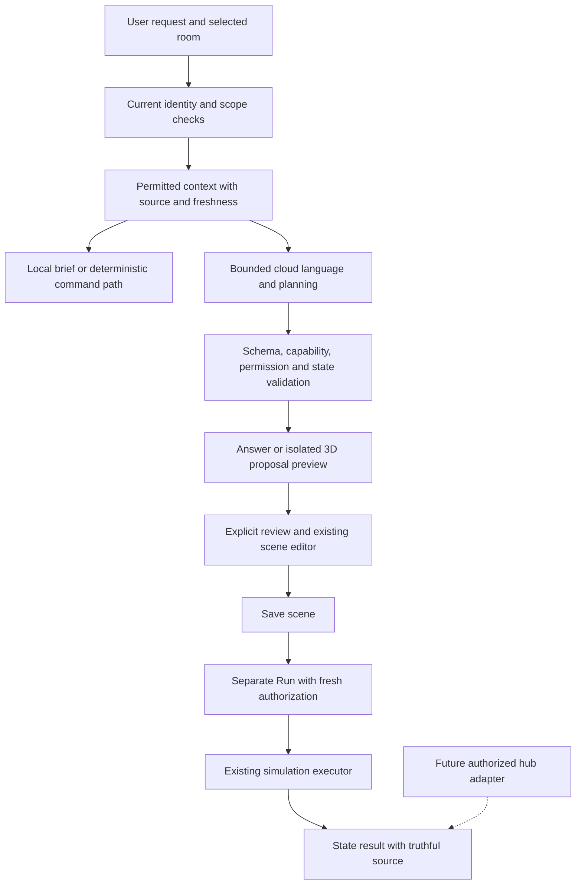

# VantaHome AI experience and capability roadmap

Researched October 22, 2026; implementation status updated the same day.
The research baseline was `55da047` on `3d-home-integration`, with application
source `410f768`. The user subsequently authorized **Phase 1**, now implemented
and verified in source/browser tests. Preview 91 is installed and launched;
Apple inventory confirms build 91. Physical acceptance is underway, with no
results recorded yet. Later phases remain design proposals.
No paid model requests, provider/schema changes or deployments were made for this slice.

## Implemented first slice and acceptance boundary

- Room-aware Ask validates the selected room against the canonical registry and
  active grants, with an explicit permitted-rooms alternative. Layout-only sharing
  does not add context. Scope changes retire requests, answers and review tokens.
- Exact before/after cards preserve captured values. Preview uses separate
  temporary rendering state, never canonical writes, storage or commands. A
  persistent **Preview · no device changes** label, Current / Proposed and Exit
  preserve the existing camera. Controls remain unavailable during comparison;
  expiry, suspension, access/scope changes and incoming affected values end it.
- Existing **Review → Create → separate Run** remains authoritative. The first
  slice does not add conversational draft refinement, routine generation, new
  telemetry sources or a model command tool.
- A separately authorized native voice slice provides a five-minute, explicit
  foreground Home consent window for “Hey VantaHome” / “Vanta”. It uses the phone's
  speech service, which may process audio, and synthetic system TTS (`expo-speech`).
  It is not a background/local wake-word engine or OpenAI Realtime integration.
  Session tokens and native cleanup protect queued work; manual Hear and ordinary
  dictation remain available. Physical permission/audio/accuracy acceptance is pending.
- Evidence: 277 host tests/20 suites (`work/ai-phase-one-jest.log`), 1,649 scene
  tests/131 suites, seven panel browser profiles/states (`work/ai-panel-browser.json`)
  and seven actual scene profiles (`work/concierge-scene-preview-browser.json`).
  The scene checks found no overflow or app errors, ≥44px actions, unchanged camera
  and canonical state, and zero storage writes or command messages. These are
  mocked-provider/browser results, not a new live-model or physical speech test.
- Preview 91 is built and signed with exact scene verification
  (`work/preview91-verification.json`); installation and launch succeeded, with
  build 91 confirmed by Apple app inventory. Physical acceptance remains open.
  Android/iPad physical testing, camera research, hub execution and
  household sync retain their deferrals. Dependency verification passes after Vite 7.3.7, Vitest/mocker 4.1.12 and
  ip-address 10.7.4 updates. Existing braces/node-forge local backports remain
  verified even though registry metadata still lists the patched versions.

## Direction

Make **Home intelligence** a way to understand and direct the actual home through
its 3D model: **Understand → Preview → Approve → Verify**.

The first implemented slice is a spatial scene director. Select a room, describe
the atmosphere, see the proposed changes on the property, then save a scene and
run it deliberately. The existing room model, sculpted controllers, scoped
assistant and scene editor make this a distinctive, achievable next step.

For VantaHome, luxury should mean comfortable spaces, predictable responses,
quiet assistance and easy recovery. Cinematic presentation should help someone
see what will happen. It should never conceal a delay, invent a sensor reading,
or turn every task into a conversation.

Keep the purple identity, large Three.js property, existing navigation and
**Ask / Controls** distinction. There is no need for another AI tab, a new
assistant brand, a renderer migration or a fleet of autonomous agents.

## What the app can actually do today

Verified against [Home concierge](HOME_CONCIERGE.md),
[context projection](../src/features/home-assistant/assistantContext.ts),
[provider adapter](../supabase/functions/_shared/conciergeProvider.ts) and
[routine availability](../src/features/routines/executionAvailability.ts).

| Area | Current implementation | Expansion needed |
| --- | --- | --- |
| Questions | Deterministic local brief and live text answers scoped to a validated selected room or permitted rooms | Weather, telemetry history, manuals and explanations based on those sources |
| Scenes | Scoped AI draft, exact before/after card, isolated in-model Current/Proposed preview, then Review → existing editor → Create; Run is separate | Bounded conversational refinement and physical Preview 91 acceptance |
| Controls | Separate explicit typed/spoken simulation commands | Real transport and observed completion remain a separate integration |
| Device context | Lights, AC, fans, blinds, TVs and speakers; only permitted fields | Capability-specific adapters before any further categories |
| Memory | One short answer in memory; no persistent conversation | Explicit personal preferences and short, isolated follow-up context |
| Voice | Dictation plus optional five-minute foreground Home listening through phone STT; synthetic system replies and manual Hear | Physical permissions/audio/accuracy, heat/battery; richer realtime audio remains future work |
| Routines | Local definitions and foreground execution | AI drafting, dry runs, durable hub execution and household sync |
| Authority | Verified membership, room/action grants, server checks and expiring review | Every new read, preview, memory and action must preserve these boundaries |

The current Responses API integration uses strict structured output, `tools: []`,
`store: false`, bounded requests and timeouts. It does not have a command tool.
Coordinates, weather, occupancy, camera content, profiles and history are not
automatically sent. The current default model is `gpt-6.1-sol`; changing it should
follow a VantaHome-specific quality/cost comparison, not a marketing ranking.

Recorded Owner, Guest and Member checks establish a useful bounded baseline.
They are not proof of every permission combination, model answer or future tool.
No hub is connected. The planned NUC 15, household sync and physical iPad testing
remain deferred.

## What current smart-home research changes about the design

These are official product/standards descriptions, not independent benchmarks.
Features can depend on region, subscription, firmware and exact equipment;
availability for this Jamaica property was not established.

| Research | Relevant finding | VantaHome design decision |
| --- | --- | --- |
| [Google Home / Gemini redesign](https://blog.google/products-and-platforms/devices/google-nest/google-home-app-gemini-redesign/) | Ask Home provides a persistent entry to device discovery, multi-device requests and automation creation; some capabilities require Premium. | Keep one familiar assistant entry across screens and link answers back to existing controls. |
| [Amazon Alexa+](https://www.aboutamazon.com/news/devices/new-alexa-top-features) | Natural language can describe complex routines, including time and weather conditions. | Let people express intent naturally, then show a precise editable routine. Conversational convenience does not remove review or safety requirements. |
| [Samsung SmartThings Now, October 2026](https://news.samsung.com/us/samsung-introduces-smartthings-now-platform-update-brings-intuitive-user-experiences/) | Contextual cards pair information with actions; routine insights and local control are part of the update. | Surface a small number of timely insights with clear next steps. Keep the user's layout stable and provide snooze/topic controls. |
| [Home Assistant Assist guidance](https://www.home-assistant.io/voice_control/best_practices/) | Deliberate entity exposure, useful names and areas reduce ambiguity and unnecessary context. | Use the canonical room/device registry, aliases and the selected room. Never send the entire property by default. |
| [Home Assistant local voice](https://www.home-assistant.io/voice_control/voice_remote_local_assistant/) | Local pipelines offer different tradeoffs for fixed commands and open-ended transcription. | Keep simple control deterministic; evaluate local voice on the future hub separately from cloud reasoning. |
| [Lutron luxury lighting](https://www.lutron.com/us/en/applications/residential/luxury-home-lighting) | Lighting, shading, scenes and physical controls are designed as a coordinated experience. | Organize intelligence around comfort and atmosphere while preserving fast manual control. |
| [Matter 1.5](https://csa-iot.org/newsroom/matter-1-5-introduces-cameras-closures-and-enhanced-energy-management-capabilities/) and [Matter 1.6](https://csa-iot.org/newsroom/matter-1-6-enables-more-intuitive-setup-multi-ecosystem-experiences-and-context-driven-control/) | The standards expand device/energy support and improve contextual control and capability reporting. Adoption varies by product. | Model capabilities and operating limits explicitly. A Matter version is not proof that a chosen device or hub supports a feature, nor a replacement for household permissions. |

Our opportunity is the connection between language, a spatial preview, precise
controls and an understandable result. The model should make existing features
easier to use before VantaHome gains more features.

## Experience direction — implemented slice above; remaining elements proposed

### 1. A contextual assistant that stays out of the way

The existing microphone opens Home intelligence. A visible scope chip says
**Living room**, **This device** or **My permitted rooms**. Scope comes from a
validated selection, not the model guessing a room from screen pixels. The user
can change it. Ambiguous names produce a short choice before a plan is drafted.

The opening surface contains one relevant brief and up to three suggested asks.
Examples are “Set an evening mood,” “Explain this device” and “What needs attention?”
Only display suggestions supported by available data and permissions. Keep
Controls immediately reachable for someone who just wants a light switched off.

Use the existing brand ring as restrained feedback: listening, preparing a plan,
preview ready and waiting for a result. Every state also has text. A ring never
means that a physical action succeeded. No whole-dashboard glow, long launch
film, artificial progress percentage or animation that delays an available answer.

### 2. The house becomes the preview

Illustrative interaction, not current property readings:

> “Make the living room feel calmer. Leave the air conditioning alone.”

1. The assistant proposes only supported, permitted comfort changes.
2. A compact plan names each affected device and the exact target. It explicitly
   says the AC is unchanged. Unsupported effects are omitted with an explanation.
3. **Preview in 3D** temporarily depicts those changes using the current model.
   A persistent **Preview · no device changes** label distinguishes it from live
   state. The user may compare Current and Proposed.
4. **Review scene** opens the existing editor. **Create** saves it without running.
   **Run scene** remains a separate action.
5. After Run, a small result card reports simulated changes. Future physical
   commands distinguish submitted, observed, partial and unconfirmed results.

The preview is a separate display layer. It must never write canonical device
state, persistence, event history, commands or automations. Cancellation removes
it immediately. New device readings, permission changes or expired review context
invalidate the affected proposal. No gate/door motion is included in an AI mood
preview. Preserve the current camera position unless the user chooses Focus room.

The visual promise is an understandable approximation of supported settings, not
a photometric simulation or a claim about the real room's appearance.

### 3. Cards that answer, explain or propose

Use three shared card types rather than a wall of chat bubbles:

| Card | Content | Primary action |
| --- | --- | --- |
| Answer | Short answer, relevant room/device, source, observation time and missing-data note | Open the existing controller or relevant detail |
| Proposal | Exact changes, reason, affected scope, exclusions, availability and expiry | Review; preview is optional |
| Result | Per-device completion or failure, reported source and unresolved items | Inspect or deliberately retry eligible items |

“Why?” reveals the observations and rules used, not hidden model reasoning. Never
attach a made-up confidence percentage. Use factual labels such as **Simulation**,
**Measured**, **Forecast**, **Estimated** and **Unavailable** where applicable.

Phone portrait uses a bottom sheet with a stable close control, scope and composer.
Tablet landscape uses a side panel with the model still visible; tablet portrait
uses a bounded lower panel. Desktop retains tablet preview. Horizontal suggestion
cards use smooth scrolling, touch momentum and restrained overscroll, without
arrow controls. Normal layouts do not scroll the whole page. Long answers,
keyboard use, very small screens and large accessibility text retain a contained
scroll fallback instead of clipped content. Announce final states, not every
streamed token; keep at least 44-point touch targets and visible keyboard focus.

### 4. Quiet, optional insight

Allow one useful insight in the existing dashboard content area, never a new
permanent header or duplicated weather display. It might say a routine has not
run because its device is unavailable, or offer a comfort change the user requested
to be reminded about. The detail sheet can hold additional insights.

Every insight needs a real source, a freshness limit, an eligible action and a
reason to appear now. Add Dismiss, Snooze and topic preferences; default to in-app
delivery. Background push, quiet hours and closed-app delivery need their own
implementation. Local rules detect conditions; an LLM may explain them. No
continuous cloud polling, automatic card reshuffling or fabricated emergencies.

## Capability priorities

| Capability | Useful experience | Data and delivery boundary |
| --- | --- | --- |
| **Spatial Ask + scene director** | Select a room and preview exact changes before saving; future refinement could say “warmer light, keep the fan as it is” | Scoped Ask/preview implemented; physical acceptance pending. Conversational refinement remains future work. Preserve one active plan and clear it on scope/account/home changes. |
| **Explain my home** | Explain an actual setting, why a supported routine did or did not run, and which device needs attention | Current settings can work now. Historical explanations need recorded events and reason codes; never infer causation from correlation. |
| **Routine designer** | Describe a trigger, conditions, exceptions and actions; inspect a dry-run timeline | Reuse Routines and Scenes. Drafting is future work; foreground execution remains explicit until hub execution is validated. |
| **Energy and water advisor** | Summarize measured usage, compare periods and suggest when to use flexible loads | Requires reliable history, units and coverage. Solar forecasts, battery reserve and tariffs are optional inputs, not invented defaults. |
| **Comfort coordinator** | Coordinate permitted light, shade, fan and AC settings around a user's chosen comfort goal | Start with explicit preferences; measured temperature, humidity or air quality require actual sensors and separate read adapters. |
| **Home care** | Explain a model-specific error, find the correct maintenance instruction, remember a user-confirmed service date | Requires identified equipment, approved manuals and grounded citations. Predictive maintenance needs adequate measured history. |
| **Natural conversation** | Short voice sessions with visual confirmation and an equivalent text route | Foreground phone-STT/system-TTS slice implemented; physical acceptance pending. Richer realtime audio remains later work with native lifecycle, latency, battery and cost validation. |
| **Personal preferences** | “Remember that I prefer dim warm light in the evening” | Explicit opt-in, editable per-person records, visible scope and deletion; household policy changes need appropriate authority. |

### Routine design must resolve real-world ambiguity

Show **When / Only if / Do / Except / Runs on**. A dry run shows the next eligible
times, required readings, conflicts and reasons an action would be skipped. Use
the property's configured timezone; handle daylight-saving changes in other homes,
missed triggers, restart recovery and late execution explicitly.

For “water the garden when it is dry,” ask whether dry means a soil reading or a
user-selected forecast rule. Rain probability does not measure soil moisture.
If the sensor or hub is absent, offer a clearly incomplete draft; do not silently
substitute a different condition. First-version AI routine actions should retain
the current comfort allowlist. Irrigation and appliances need later adapters and
their own operating limits before execution is offered.

Define manual overrides, cooldowns, maximum duration and conflict policy in
ordinary execution code. A recent manual adjustment wins over a comfort suggestion
for a visible hold period. Conflicting household preferences require a deliberate
household policy; the model should not decide whose preference matters more.

### Energy advice must earn its precision

Home Assistant separates electricity, gas and water data and supports production,
storage and consumption views. These require suitable sources; a power reading
is not itself an energy total. [Home Assistant energy documentation](https://www.home-assistant.io/docs/energy/)

VantaHome should calculate totals and costs deterministically from validated
readings, units, meter resets, sample gaps and the applicable billing interval.
The AI explains the result. Show coverage and estimate assumptions. Do not infer
a tariff, currency or time-of-use schedule from the property location. A solar
forecast is a prediction, not available power; a modeled battery is not a measured
reserve. Do not claim a percentage saving before a defensible baseline exists.

Without history, “Why was electricity higher yesterday?” should explain the
missing input and offer the relevant setup path. It must not invent an AC diagnosis.
Local leak/alarm rules and hardware protection must operate independently of AI.

### Voice and memory should feel personal without becoming intrusive

The implemented foreground voice slice reuses phone recognition and synthetic
system output. Later, evaluate richer OpenAI conversational audio using short
authenticated sessions. WebRTC documentation demonstrates server-minted
ephemeral client credentials; a standard API key stays on the server. This does
not establish compatibility or performance in our React Native app.
[OpenAI WebRTC guidance](https://developers.openai.com/api/docs/guides/voice-webrtc?voice-api=realtime)

No always-listening phone mode. Show an unmistakable listening state and Stop;
release the microphone on backgrounding and interruption. Test Jamaican English,
room aliases, noise, headphones, phone calls and interrupted confirmations.
Voice identity is not authorization. A television or visitor speaking is not an
authenticated approval. Interrupting an answer does not undo an already sent action.

Separate personal preferences, household rules and transient conversation. Offer
“Remember this” only for a specific inspectable preference. Guest records cannot
outlive their allowed use; account/home changes clear transient context. A future
Forget flow must distinguish deleted preferences from any required minimal audit
record. Household/profile sync remains a prerequisite for cross-device promises.

## Architecture: extend the current system

The future hub is not part of this implementation phase. Its executor, observations
and durable scheduling need separate integration and acceptance.

1. **Canonical context.** Extend the existing registry with typed read projections:
   device identity, room, supported fields/ranges, value/unit, source, observed time,
   quality and simulation/physical mode. Retain account/home/grant revisions locally
   or server-side for authority; do not send private identity fingerprints to the
   provider. Registry aliases survive rename and reposition through stable IDs.
2. **Purpose-limited reads.** Initially keep the bounded snapshot. When justified,
   add narrow read tools for authorized current state, scoped historical aggregates
   and approved manual passages. Bound tool count, result size and request time.
   No arbitrary SQL, URL fetching, shell access or generic Home Assistant service tool.
3. **Typed proposals.** Reuse shared schemas, exact field semantics and the existing
   review handoff. Validate capabilities, field ranges, target scope and current
   grants outside the model. Structured JSON can still contain semantic mistakes.
   [OpenAI structured-output guidance](https://developers.openai.com/api/docs/guides/structured-outputs)
4. **Application-owned actions.** The model proposes; application code decides
   whether a call is permitted and executes it. This matches the separation in
   [OpenAI function calling](https://developers.openai.com/api/docs/guides/function-calling).
   Do not give the model a way to approve its own proposal.
5. **Truthful execution.** Use explicit target values and idempotency keys instead
   of retrying toggles. Revalidate before Run and at the executor. A changed snapshot
   prompts a refreshed review. Track each result; submission is not observation.
   On timeout, show unconfirmed and reconcile before retrying. Multi-device actions
   can partially succeed; never claim an all-or-nothing transaction unless supported.
6. **Bounded recovery.** Only offer Undo for reversible, permitted comfort changes
   whose relevant state has not changed again. Never undo another household member's
   newer choice. A saved scene is intent, not continuing authorization to execute it.

Keep React Native, the Three.js scene, Supabase authorization and the current
Responses adapter. Preserve simple on-device commands and local briefs during
provider failure where current authority permits them. Never bypass failed home
verification to advertise offline control. A future local-hub authorization policy
must explicitly handle expiry, revocation, network partitions and reconnect.

Use one bounded planning workflow before considering multiple agents, a new
framework, fine-tuning or a vector database. Small, model-specific manuals may only
need indexed text retrieval; introduce more infrastructure when measured needs
justify it. New provider models should be compared behind the existing adapter.

## Security, privacy and household boundaries

| Boundary | Required behavior |
| --- | --- |
| Roles and grants | Server checks every read and action. Member scene creation still requires effective `automation.manage`; Guest defaults do not gain drafting. Overrides and expiry win over role labels. |
| Shared property geometry | Viewing the exterior or a shared interior never exposes hidden device readings, cameras, occupancy, activity, names or aggregates through AI. |
| New data sources | Weather/manuals/history need explicit field allowlists and purpose-specific access. Prefer the necessary weather facts over sending coordinates. |
| Untrusted content | Device names, manuals, transcripts and external data are data, not instructions. They cannot add tools, broaden scope or authorize actions. Validate source references rather than accepting invented citations. |
| Conversation and cache | Scope by actor, home and grant revision; short freshness limits. Clear on logout/switch, discard late responses and recheck on resume. Hidden data must not survive in answer cards, previews, notifications or accessibility text. |
| Sensitive devices | AI expansion does not grant control of doors, gates, garage access, opening windows, gas, cooking or alarm disarming. Existing explicit controllers keep their own rules. AI is never a fire, obstruction or life-safety interlock. |
| Cameras | Follow the separate [camera design](CAMERA_EXPERIENCE_DESIGN.md). No camera analysis, cloud frames, biometric inference or media pilot is authorized by this plan. |
| Autonomy | Later unattended actions need a user-approved bounded rule executed locally, with limits and an off switch. Do not ask an LLM to improvise unattended physical actions. |

Retain server-only provider secrets, `store: false` and content-free operational
logging. OpenAI documents that API data is not used for training by default, but
default abuse-monitoring retention can include content for up to 30 days, with
exceptions. `store: false` is not zero retention; files, conversation storage and
other endpoints have distinct policies. Review actual account settings before
adding audio, retrieval storage or imagery. [OpenAI data controls](https://developers.openai.com/api/docs/guides/your-data)

Preserve the existing restricted private-home pilot. This roadmap does not expand
hardware scope, authorize public/customer release or replace independent security
review. Do not infer safety from passing a finite test suite.

## Delivery sequence and acceptance gates

Phase 1 and the bounded foreground voice slice are authorized and implemented in
source; Preview 91 packaging is verified and physical acceptance remains pending. Later phases need a
subsequent request. Camera work, hub purchase/pairing, household sync and physical
iPad testing retain their existing deferrals.

| Phase | Deliverable | Gate before calling it complete |
| --- | --- | --- |
| **1 — Spatial Ask and preview** | Implemented: room-aware context, one scoped scene draft, isolated 3D preview, exact change card and existing Review/Create/Run flow | Source/browser checks pass; Preview 91 installed and launched, with physical preview/save/run/persistence acceptance pending. Refinement is not included yet. |
| **2 — Grounded explanations** | Source/time labels, relevant weather facts, explicit preferences and scoped Device Health explanations | Verified read adapters; no invented history or causation; privacy/delete lifecycle; safe unavailable states |
| **3 — Routine drafting** | Canonical editable draft and dry-run explanation using supported comfort actions | Trigger/condition/exception tests, timezone and conflict policy; foreground-only label until durable execution exists |
| **4 — Measured home intelligence** | Energy/water summaries, maintenance evidence and opt-in insight cards | Real telemetry quality/history, authorized integration and deterministic math; no fabricated savings or unattended expansion |
| **5 — Natural voice and bounded automation** | Bounded foreground phone-STT/system-TTS slice implemented early; richer realtime audio and approved hub policies remain proposed | Physical interruption/battery/permission/accuracy tests pending; future cloud audio, hardware authority, observed completion and durable execution remain separate gates |

The bounded foreground voice slice was authorized alongside Phase 1. It does not
complete the richer audio or hub-policy phase. Phase 4's useful
metrics are unavailable until the necessary telemetry exists. Do not present these
phases as a dated delivery promise before estimating actual implementation work.

### Proposed evaluation and operating budgets

Create a repository-owned regression set with at least 120 scenarios across
ordinary requests, paraphrases/aliases, ambiguous rooms, role/override combinations,
expiry, malicious names/manual text, partial failures and reconnects. Use synthetic
or explicitly consented examples, not unrestricted logging of household questions.
Combine task-specific checks with human review, consistent with
[OpenAI evaluation guidance](https://developers.openai.com/api/docs/guides/evaluation-best-practices).

- Require zero unauthorized reads/actions and zero preview writes in the release
  suite. This is a release criterion, not a universal security guarantee.
- Target at least 95% correct device/field/value selection on supported, unambiguous
  held-out scene tasks. Reject 100% of invalid targets and values at the validator.
- Require all factual home values to resolve to allowed evidence or explicitly
  report unavailable. No generated fact may silently become a device observation.
- Verify save-without-run, Home/Devices agreement and restart retention. Test
  role revocation during generation, preview, review, save and Run.
- Preserve existing request/rate limits initially. Add measured per-request token,
  latency and error metadata, per-home budget policy and a hard application spend
  cutoff before introducing background work or cloud realtime audio. The current phone-voice slice uses the existing bounded text request limits. Prevent duplicate requests.
- Aim for immediate local acknowledgement (provisional target under 200 ms on
  supported hardware); measure cloud p50/p95 instead of promising a fixed delay.
  Preserve cancel and current 20/25-second deadlines. Earlier two-answer timings
  are not a benchmark. Rendering or streaming must not execute partial proposals.
- Test iPhone/Android portrait, tablet portrait/landscape and desktop preview;
  include large text, screen reader, keyboard and reduced motion. Physical iPad
  remains deferred; browser layout evidence cannot substitute for it.
- Recheck heat/frame pacing with 3D plus voice. No unbounded/background listening or idle
  model calls; stop work on backgrounding. Establish a controlled battery baseline
  before claiming efficiency improvements.

Track user corrections, successful reviewed scenes, dismissed suggestions and
unconfirmed commands through privacy-conscious counters. Optimize helpful outcomes
and reduced effort, not conversation length or number of AI interactions.

## Next acceptance step

Finish **Phase 1: Spatial Ask + reviewed 3D scene preview** physical
acceptance before expanding its scope. Verify no-state-change preview, scoped
before/after review, save-without-run, explicit Run and local persistence on the
installed build. Test native opt-in voice permissions, interruptions, Stop/deadline,
route/background cleanup and recognition accuracy separately from text/scene behavior.

Keep [Home concierge](HOME_CONCIERGE.md) as the implemented-behavior record and
[implementation backlog](IMPLEMENTATION_BACKLOG.md) as the delivery authority.
Later explanations, refinement, routine drafting and new data sources remain
proposals until separately authorized and verified.
